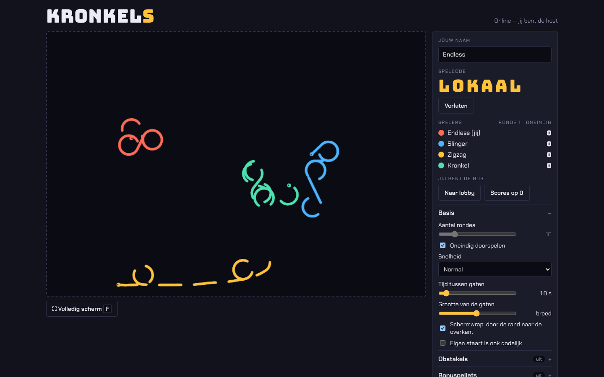
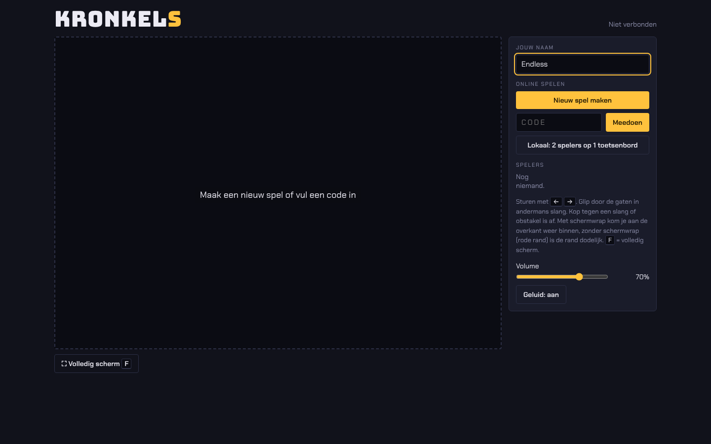
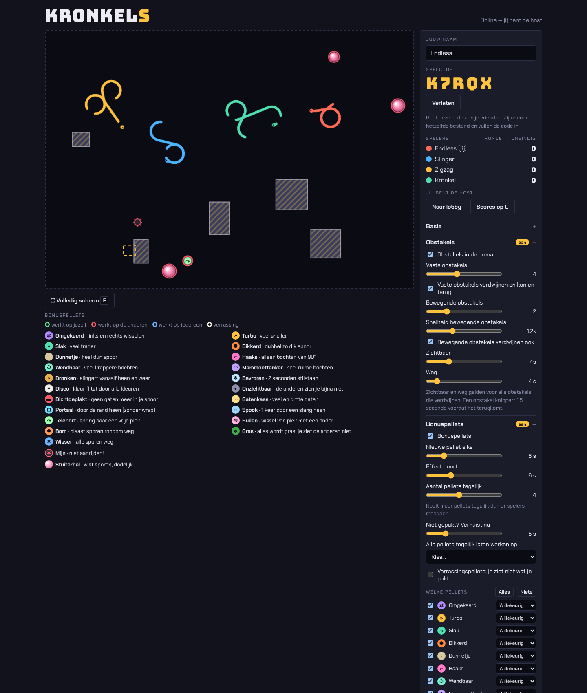
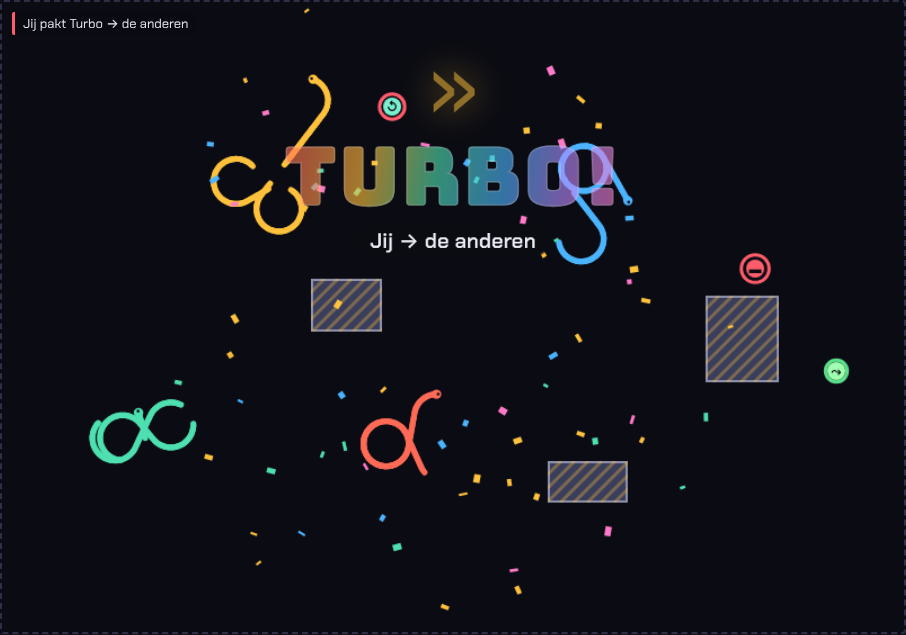
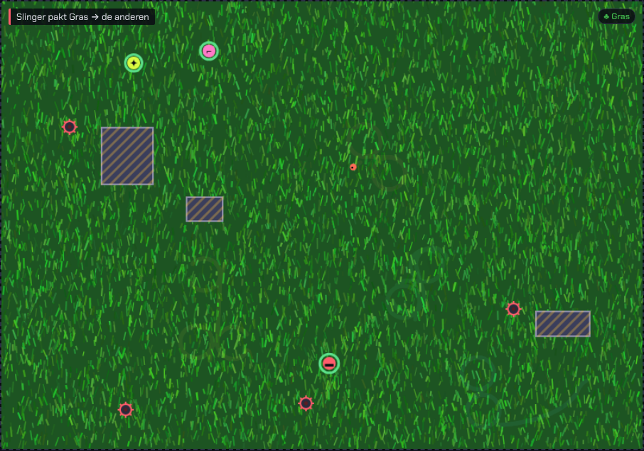
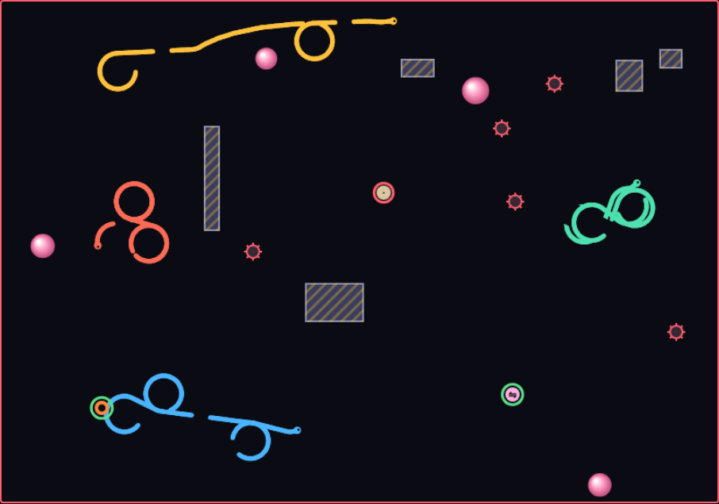
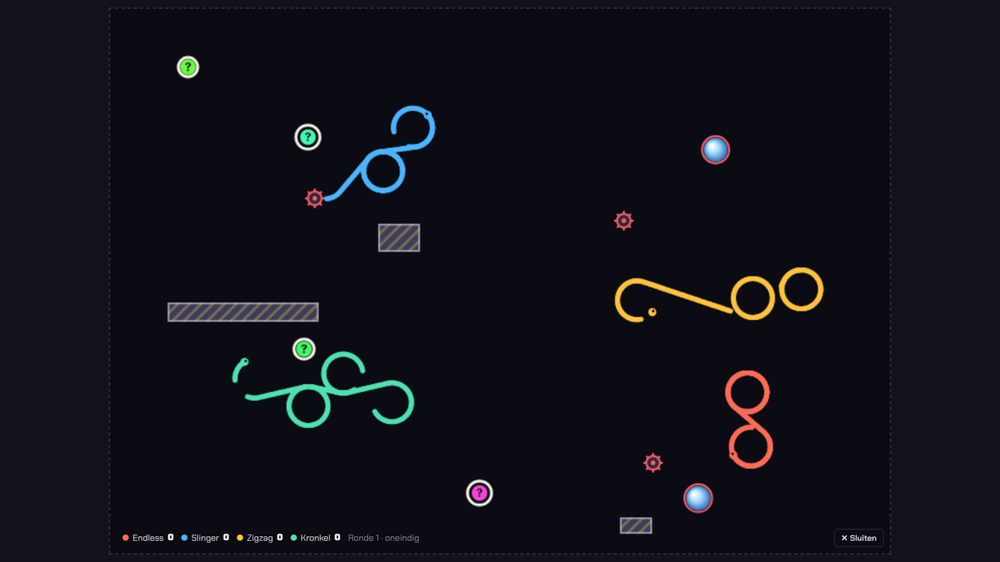
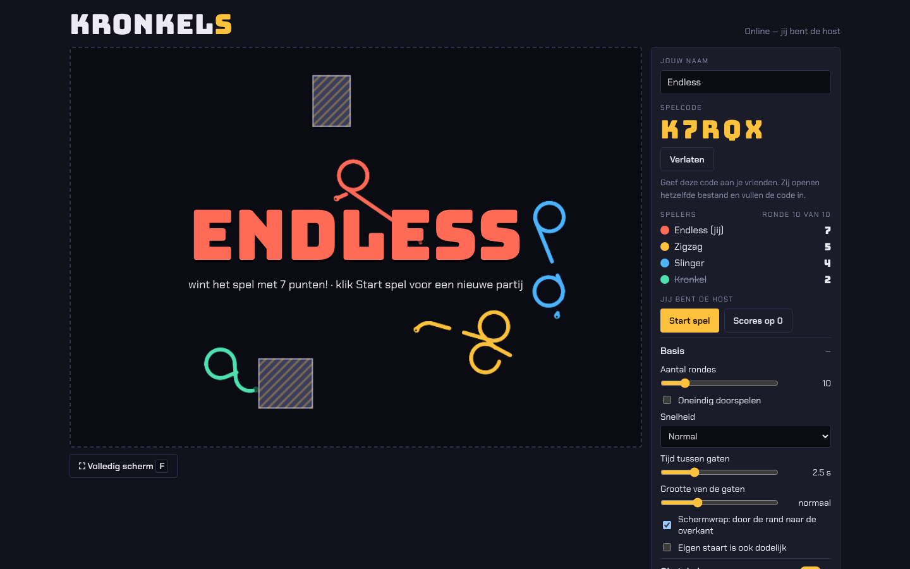

# Kronkels

Multiplayer slangenspel voor de browser. Je slang gaat altijd vooruit, jij stuurt alleen naar links of rechts. Sluit je tegenstanders in, glip zelf door de gaten in hun spoor en blijf als laatste over.

**▶ Spelen:** https://endless1977.github.io/Kronkels/

## Zo werkt het

- Elke slang laat een spoor achter, met af en toe een gat waar je doorheen kunt.
- Raak je met je kop een slang, een obstakel of (zonder schermwrap) de rand, dan ben je af.
- De laatste overlevende krijgt een punt. Na een paar seconden begint vanzelf de volgende ronde.
- Na het ingestelde aantal rondes komt de eindstand in beeld. Je kunt ook oneindig doorspelen.

## Samen spelen via internet

1. Open het spel en vul je naam in.
2. Eén speler klikt op **Nieuw spel maken** en krijgt een spelcode van vijf tekens.
3. De anderen vullen die code in en klikken op **Meedoen**.
4. De host kiest de instellingen en klikt op **Start spel**.

De verbinding is peer-to-peer (via PeerJS): er is geen eigen server nodig. De computer van de host rekent het spel uit, dus laat dat venster op de voorgrond staan.

Geen internet of samen achter één toetsenbord? Kies **Lokaal: 2 spelers op 1 toetsenbord**.

## Besturing

| | Toetsen |
|---|---|
| Speler (online) | <kbd>←</kbd> <kbd>→</kbd> |
| Lokaal speler 1 | <kbd>←</kbd> <kbd>→</kbd> |
| Lokaal speler 2 | <kbd>A</kbd> <kbd>D</kbd> |
| Volledig scherm | <kbd>F</kbd> (sluiten met <kbd>Esc</kbd> of <kbd>F</kbd>) |

Op telefoon en tablet verschijnen grote ◀ ▶-knoppen onder de arena.

## Instellingen voor de host

**Basis**
- Aantal rondes (1–50) of oneindig doorspelen
- Snelheid: Slow, Normal, Medium, Hard, Insane, Ludicrous
- Tijd tussen gaten en grootte van de gaten
- Schermwrap aan (door de rand naar de overkant) of uit (de rand is dodelijk)
- Eigen staart ook dodelijk

**Obstakels**
- Vaste obstakels, die desgewenst periodiek verdwijnen en terugkomen
- Bewegende obstakels die door de arena zwerven, met eigen snelheid en ook te laten verdwijnen
- Instelbaar hoe lang ze zichtbaar en weg zijn; een obstakel knippert voordat het terugkomt

**Bonuspellets**
- Hoe vaak er een nieuwe komt, hoe lang een effect duurt en hoeveel er tegelijk liggen (nooit meer dan het aantal spelers)
- Een pellet die niet gepakt wordt, verhuist na een instelbare tijd naar een andere plek
- Per pellet kiezen of hij werkt op jezelf, de tegenstanders of willekeurig
- Verrassingspellets: je ziet pas wat het is als je hem pakt

**Stuiterballen**
- Aantal, grootte en snelheid
- Gum: ballen wissen de sporen waar ze overheen rollen
- Dodelijk of ongevaarlijk

**Mijnen**
- Maximaal aantal en hoe vaak er een bijkomt
- Verstopte mijnen worden na 2 seconden bijna onzichtbaar

## Bonuspellets

Pakt iemand een pellet, dan verschijnt de naam groot in beeld, met confetti en een eigen geluid. De ring om een pellet laat zien op wie hij werkt: groen op jezelf, rood op de anderen, blauw op iedereen.

| Pellet | Effect |
|---|---|
| ⇄ Omgekeerd | links en rechts wisselen |
| » Turbo | veel sneller |
| « Slak | veel trager |
| ● Dikkerd | dubbel zo dik spoor |
| · Dunnetje | heel dun spoor |
| ⌐ Haaks | alleen bochten van 90° |
| ↺ Wendbaar | veel krappere bochten |
| ◠ Mammoettanker | heel ruime bochten |
| ~ Dronken | slingert vanzelf heen en weer |
| ❄ Bevroren | 2 seconden stilstaan |
| ✦ Disco | kleur flitst door alle kleuren |
| ◐ Onzichtbaar | de anderen zien je bijna niet |
| ▬ Dichtgeplakt | geen gaten meer in je spoor |
| ⋯ Gatenkaas | veel en grote gaten |
| ⊡ Portaal | toch door de rand heen (alleen zonder schermwrap) |
| ◌ Spook | één keer door een slang heen |
| ⤳ Teleport | spring naar een vrije plek |
| ⇋ Ruilen | wissel van plek met een tegenstander |
| ✹ Bom | blaast de sporen rondom weg |
| ♣ Gras | de arena wordt gras en je ziet de anderen niet meer |
| ✕ Wisser | alle sporen weg |

## Stuiterballen en mijnen

Stuiterballen kaatsen van de randen en obstakels af. Met de gum aan vreten ze stukken uit de sporen, zodat er nieuwe ontsnappingsroutes ontstaan. Mijnen zijn één seconde na verschijnen scherp; wie erop rijdt is af en blaast de sporen rondom weg.

## Volledig scherm

Met <kbd>F</kbd> of de knop **Volledig scherm** wordt de arena zo groot mogelijk, met een kleine scorebalk onderin. Elke speler zet dit zelf aan.

## Eindstand

## Geluid

Alle geluiden worden in de browser opgewekt (Web Audio), er zijn geen geluidsbestanden. Elke pellet heeft een eigen geluid, en er zijn geluiden voor het aftellen, de start, botsingen, stuiterende ballen, mijnen en de winnaar. Volume en geluid aan/uit stelt iedere speler zelf in.

## Techniek

- Eén HTML-bestand (`index.html`), geen build-stap of installatie
- Online spelen via [PeerJS](https://peerjs.com/) (WebRTC, peer-to-peer)
- Werkt in Chrome, Edge en Firefox; Chrome of Edge aanbevolen
- Lokaal spelen: open `index.html` gewoon in de browser
